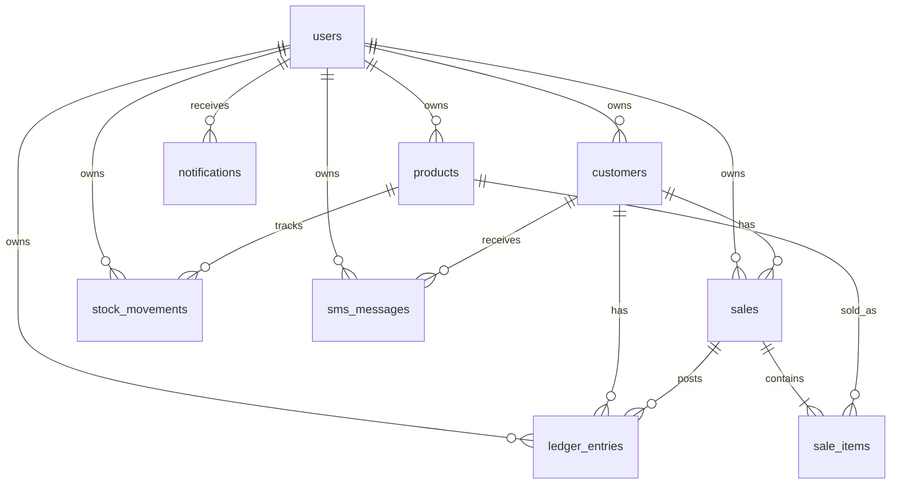

# Smart Digital Khata

A small-shop management web app for Kirana and general stores. It replaces the paper khata
(udhaar notebook) with a mobile-friendly ledger, adds simple inventory tracking with low-stock
alerts, and lets the shopkeeper send payment reminders with a private statement link.

Built as a solo final-year project for the University of Malakand.

---

## Features

| Area | What it does |
|---|---|
| **Digital khata** | Customers with opening balance, udhaar and payment entries, running balance, printable statement. Balances are always derived, never stored. |
| **Shop ledger** | One page listing every udhaar and payment across all customers, with date/type/customer filters. |
| **Inventory** | Products with unit, purchase price, sale price, stock and low-stock threshold. Stock in / out / set-count adjustments, each recorded in a movement history. |
| **Low-stock alerts** | A product at or below its threshold raises exactly one in-app notification; restocking clears it so a future crossing alerts again. |
| **Mini POS** | Single-screen sale: search products, live cart, editable quantity and price, discount, cash or udhaar. Udhaar sales post to the customer's khata automatically. |
| **Receipts** | Printable sale receipt and printable customer statement (A4 print styles). |
| **Void sales** | Voiding a sale restores stock and reverses its khata entry. Sales are never deleted. |
| **Reports** | Dashboard with 7-day sales chart, receivable ageing (FIFO), sales report and stock valuation. CSV export on every report. |
| **SMS reminders** | Driver-based SMS (`log`, `twilio`, `http`), a daily scheduled run, a manual "send reminder" button, and full message history. |
| **Public statement** | Unguessable token link (`/s/{token}`) showing the balance and last 20 entries. Read-only, rate-limited, `noindex`. Copy-link and WhatsApp share buttons. |
| **Multi-shop isolation** | Every business row carries `user_id`; policies and scoped queries stop one shop seeing another's data. |

Out of scope by design: barcode scanners, receipt printers, partial payments, returns/refunds,
multi-user staff accounts, and real payment-gateway integration.

---

## Demo account

The seeder creates a ready-to-explore shop:

```
Email:    demo@khata.test
Password: password
Shop:     Rahman General Store
```

It includes 12 customers, 18 products, around 130 sales and a mix of udhaar/payment history.

---

## Tech stack

- **PHP 8.3** + **Laravel 12**
- **Blade** templates, **Alpine.js** for the POS cart and menus
- **Tailwind CSS 3** + `blade-ui-kit/blade-heroicons`
- **Chart.js** for the dashboard chart
- **SQLite** for local development and demos; the schema and queries are MySQL-compatible
- **Pest / PHPUnit** for the test suite (84 tests, 262 assertions)

---

## Getting started

Requirements: PHP 8.2+ with `pdo_sqlite`, `mbstring`, `openssl`, `fileinfo`, `xml`, `curl`;
Composer 2; Node 20+ and npm.

```bash
composer install
npm install

cp .env.example .env        # Windows: copy .env.example .env
php artisan key:generate

# SQLite (default). Create the file if it does not exist:
#   Windows: type nul > database/database.sqlite
#   macOS/Linux: touch database/database.sqlite

php artisan migrate --seed
npm run build
php artisan serve
```

Open <http://127.0.0.1:8000> and log in with the demo account.

For development with hot reload, run `npm run dev` in a second terminal.

### Useful commands

```bash
php artisan test                      # run the Pest suite
php artisan migrate:fresh --seed      # reset to the demo data
php artisan khata:send-reminders --dry-run   # list who would be reminded
php artisan khata:send-reminders             # send / log reminders now
php artisan schedule:list                    # confirm the daily 10:00 job
```

---

## How the money works

The single most important rule: **a balance is never stored**. It is calculated as

```
balance = opening_balance + sum(udhaar entries) − sum(payment entries)
```

- A positive balance means the customer owes the shop; a negative balance is an advance.
- Sales marked *udhaar* create a ledger entry linked by `sale_id`, so a sale and its khata entry
  can never drift apart.
- Voiding a sale restores stock and deletes its ledger entry inside one database transaction.
- Receivable ageing applies payments FIFO (oldest debt first), and the opening balance is treated
  as the oldest debt, dated from when the customer was created.

The logic lives in `app/Services/KhataService.php`, `SaleService.php`, `StockService.php`,
`LowStockService.php`, `ReminderService.php` and `ReportService.php`.

---

## Architecture

```
app/
├── Console/Commands/SendPaymentReminders.php   scheduled reminder run
├── Http/
│   ├── Controllers/                            thin controllers, one per area
│   └── Requests/                               validation rules
├── Models/                                     Eloquent models and relations
├── Policies/                                   per-shop ownership checks
├── Services/                                   balance, sales, stock, alerts, reminders, reports
└── Notifications/LowStockNotification.php      database notification
resources/views/                                Blade pages, components and error pages
routes/web.php                                  app routes (public /s/{token} outside auth)
routes/console.php                              daily reminder schedule
tests/Feature/                                  khata, stock, POS, reports, reminders, errors
```

Request flow for a sale:

1. `StoreSaleRequest` validates the cart, payment method and customer ownership.
2. `SaleService::createSale()` runs in a transaction: re-checks stock, creates the sale and items,
   decrements stock, writes stock movements, posts the udhaar ledger entry, runs the low-stock
   check, and assigns the `INV-00001` invoice number.
3. The receipt page is the sale's `show` view; voiding reverses the same steps.

### Database ERD



Key columns:

- `users` — shop profile (`store_name`, `store_phone`, `store_address`), reminder settings
  (`sms_enabled`, `reminder_after_days`).
- `customers` — `opening_balance`, `public_token`, soft deletes.
- `ledger_entries` — `type` (`udhaar`/`payment`), `amount`, `entry_date`, nullable `sale_id`.
- `products` — `stock_qty`, `low_stock_threshold`, `low_stock_notified_at`, `is_active`.
- `sales` — `invoice_no`, `subtotal`, `discount`, `total`, `payment_method`, `voided_at`.
- `stock_movements` — `type` (`in`/`out`/`adjustment`), signed `quantity`.
- `sms_messages` — `provider`, `status`, `body`, `error`.

---

## SMS configuration

The default driver is `log`: reminders are written to `sms_messages` and nothing leaves the
server, which keeps demos free and safe. To use a real gateway, set these in `.env`:

```dotenv
SMS_DRIVER=twilio
SMS_FROM=+1234567890
TWILIO_SID=...
TWILIO_TOKEN=...
```

or an HTTP gateway:

```dotenv
SMS_DRIVER=http
SMS_HTTP_URL=https://gateway.example/api/send
SMS_HTTP_KEY=...
```

Drivers implement `App\Services\Sms\SmsDriver`. Reminders include the customer name, balance,
shop name and the public statement link. The scheduled command runs daily at 10:00 in
`APP_TIMEZONE` when `php artisan schedule:run` is on cron.

---

## Deployment

### cPanel / shared hosting (PHP 8.3 + MySQL)

1. Create a MySQL database and user in cPanel.
2. Upload the project **outside** `public_html`, then point the domain's document root to the
   project's `public/` folder (or upload `public/` contents to `public_html` and adjust
   `index.php` paths).
3. Set `.env`:

   ```dotenv
   APP_ENV=production
   APP_DEBUG=false
   APP_URL=https://yourdomain.com
   DB_CONNECTION=mysql
   DB_HOST=127.0.0.1
   DB_DATABASE=...
   DB_USERNAME=...
   DB_PASSWORD=...
   SMS_DRIVER=log
   ```

4. Run:

   ```bash
   composer install --no-dev --optimize-autoloader
   php artisan key:generate
   php artisan migrate --force
   php artisan storage:link
   php artisan config:cache
   php artisan route:cache
   php artisan view:cache
   npm ci && npm run build     # or upload the built public/build folder
   ```

5. Add the scheduler cron:

   ```
   * * * * * cd /home/USER/project && php artisan schedule:run >> /dev/null 2>&1
   ```

6. Enable HTTPS (AutoSSL) and keep `APP_DEBUG=false`.

### Railway / Render (quick demo)

- Add a MySQL service and copy its connection values into the environment variables above.
- Build: `composer install --no-dev --optimize-autoloader && npm ci && npm run build`
- Start: `php artisan migrate --force && php artisan serve --host=0.0.0.0 --port=$PORT`
- Set `APP_ENV=production`, `APP_DEBUG=false`, `APP_KEY` and `APP_URL`.
- The free tiers sleep when idle; the first request after a sleep is slow.

---

## Testing

```bash
php artisan test
```

The suite covers balance rules, ledger validation and ownership, stock adjustments and the
low-stock notification lifecycle, sale totals/stock/ledger effects, voiding, report figures and
CSV exports, reminder scheduling and the public statement (including token 404s), plus the styled
error pages.

---

## Report assets

The app is demo-ready; screenshots for the written report are best taken from a running instance:

1. `php artisan migrate:fresh --seed && php artisan serve`
2. Log in as the demo user.
3. Capture: dashboard, customers list, customer khata, POS cart, sales list, stock list,
   receivables report, sales report, public statement (open the customer link in a private window).

Use a 1440×900 desktop viewport and a 390×844 mobile viewport for the responsive comparison.
The seeded data is designed to show low-stock items, overdue receivables and a mix of cash and
udhaar sales.

---


